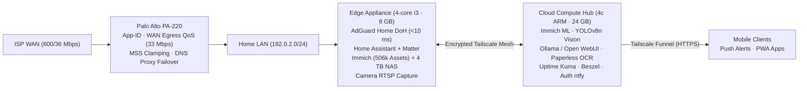

# Hybrid Cloud & Edge Homelab Architecture Portfolio

A production-grade hybrid infrastructure combining an **enterprise edge firewall (Palo Alto PA-220)**, a **low-latency local LAN appliance**, and an **ARM64 Oracle Cloud compute hub** connected over an encrypted WireGuard/Tailscale mesh.

> *All IP addresses, hostnames, and identifiers in this repository are sanitized RFC 5737 / RFC 1918 placeholders.*

---

## System Topology

---

## Key Engineering Highlights

### 1. Enterprise Edge Networking & Bufferbloat Elimination (Palo Alto PA-220)
* **WAN Egress QoS Shaping:** Configured a multi-class QoS profile capped at ~92% of measured ISP upload (`33 Mbps` on a `36 Mbps` link) with **Class 1 Real-Time** priority for DNS, Zoom, Teams, Meet, and RTP—eliminating upload bufferbloat during large off-site backups.
* **FastPath & TCP Tuning:** Applied TCP MSS clamping (`mssadjv4: 40`), re-enabled QUIC/HTTP3, and tuned `timeout-tcp-half-closed: 30s` + `timeout-udp: 30s`, achieving **~20 ms CDN latency, ~2 ms jitter, and 0% packet loss**.
* **High-Availability DNS:** Local **AdGuard Home** (encrypted DoH upstreams, `64 MB` optimistic cache, Tier-1 cgroup priority) with automatic PA-220 `LAN-DNS-Proxy` failover to `1.1.1.1`.

### 2. Cloud-First Compute Offload & 2-Tier Cgroup v2 Scheduling
* Separated **latency-sensitive LAN workloads** (DNS, `<50 ms` local smart-home control via Matter/Emulated Hue, RTSP camera capture, 4 TB local photo NAS) from **compute-heavy workloads** (ML inference, YOLOv8n vision, OCR, LLMs, scrapers, monitoring).
* Configured **2-Tier Cgroup v2 weights** (`cpu_shares: 2048` / `blkio_weight: 1000` for Tier-1 DNS & smart home vs. `cpu_shares: 128` / `blkio_weight: 100` for background workloads), maintaining **sub-10 ms DNS** under load.

### 3. Large-Scale Photo Recovery & Immich Optimization (`506,000+` Assets)
* Recovered, deduplicated, and cataloged **506,600+ family photos and videos** across 5 drives onto a `4 TB` ext4 archive with an offline cold backup.
* Built a verified, EXIF-preserving `.NEF` → full-res JPEG pipeline (`131,964` files converted, reclaiming **`2.1 TB`** of storage while preserving `6016×4016` resolution and original timestamps).
* Tuned PostgreSQL + VectorChord (`pg_prewarm` covering indexes, `vchordrq.probes = 2`, offloaded ML inference to Oracle Cloud), achieving **`<150 ms` Explore loads** and **sub-10s semantic Smart Search** across half a million assets.
* Implemented automated off-host compressed PostgreSQL DR dumps (`2.1 GB`) to the cloud survival vault.

### 4. Security Hardening & Patch Governance
* **Zero-Trust Push & Monitoring:** Consolidated all notifications onto a single auth-protected `ntfy` hub (`auth-default-access: "deny-all"`, `chmod 600` `.env` bearer tokens, Tailscale-primary with HTTPS Funnel fallback).
* **Host Hardening:** Key-only SSH, `fail2ban` on all hosts, `ufw` + persisted `DOCKER-USER` rules blocking plain-HTTP LAN exposure, least-privilege non-`sudo` service users for public-facing web apps, and automated Sunday low-risk container patching with pre-run backups, port health checks, and automatic image rollback.

---

## Featured Applications Built
* **Algorithmic Trading Bot & Supervisor:** Automated equity desk with risk guardrails, live web dashboard, and health/stale-loop alerting.
* **Little Learners & Adaptive Learning Coach:** Early-childhood reading/math web app with Kokoro IPA-phonemized voice narration, adaptive step progression, mastery tiers, and a parent analytics dashboard.
* **Camera Vision Pipeline:** Zero-CPU RTSP event capture paired with an offloaded **YOLOv8n ONNX** (`~170 ms`) classifier, stationary-vehicle filtering, foliage masking, animated GIF previews, and a 1-tap feedback loop.
* **Personal Finance & Inventory Tools:** Self-hosted debt/payoff planner (FinShield), real-time auction & store platform, and isolated FileBrowser Quantum PWA dropzone.
